# MondoWrite

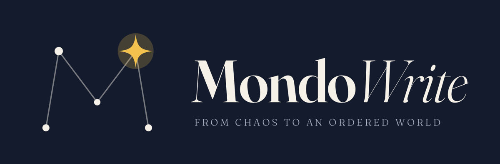

[Français](README.md) · **English**

**From chaos to an ordered world: a canvas for novelists and screenwriters who build their story before writing it.**

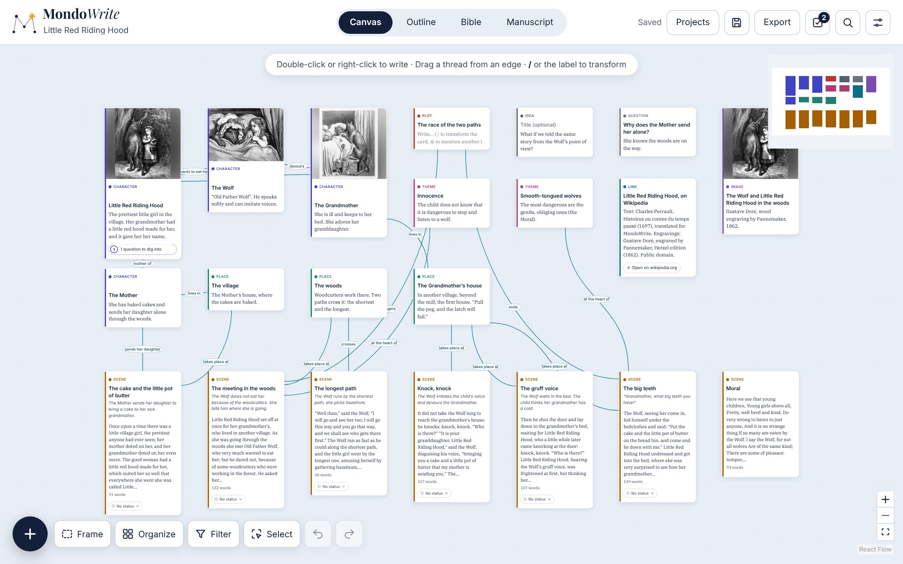

<a href="https://youtu.be/o6AGiJrQib4">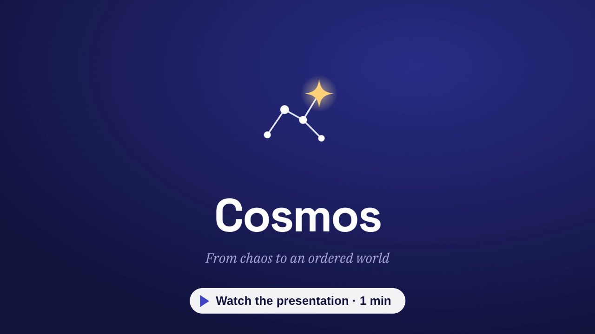</a>

[Download](#download) · [Features](#features) · [AI](#ai-if-you-want-it) · [Platforms](#platforms) · [Development](#development)

---

## ✍️ Novelists, screenwriters

A story never starts at chapter one. It starts with fragments: an image, a character, a place, a question with no answer yet.

Then you have to hold it all together: an idea board on one side, a word processor or a screenwriting app on the other, scattered notes, character sheets copied three times over… Chaos before order.

MondoWrite brings it all into one place, from the first fragment to the printed book or the screenplay ready to send.

## 📐 What MondoWrite does

```text
   [ IDEAS & FRAGMENTS ] ──► ( Interactive canvas )
                                     │
           ┌─────────────────────────┼─────────────────────────┐
           ▼                         ▼                         ▼
   [ STORY BIBLE ]          [ OUTLINE & STRUCTURES ] [ MANUSCRIPT OR SCREENPLAY ]
   Synced character and     Save the Cat, Harmon,    Markdown and Fountain
   place sheets, no retype  Hauge… or your own       files, on your machine
```

- **4 views, 1 single content.** Canvas, Bible, Outline and Manuscript stay in sync: change a character trait on the Canvas and the Bible updates. You never copy the same information twice.
- **The scene where you imagined it.** Every Scene card holds its text, its synopsis and its status (draft, to revise, done). Write it in the expanded card or in the Manuscript.
- **A true screenplay editor.** Industry format, live page and minute count, outline, character and location completion, Fountain and Final Draft import and export.
- **Proven structures, or your own.** Three acts, Save the Cat!, the Hero’s Journey, Dan Harmon’s story circle, Freytag, Hauge, seven points, kishōtenketsu, romance, mystery, eight sequences, TV episode, and your own templates. The story ribbon shows how much room each beat really takes, and a timeline by plotline spots at a glance where a subplot fades out.
- **The character sheet as a dramatic engine.** Wants, Needs, Wound, in three readable boxes, and an assistant that asks you the right questions.
- **From first draft to printed book.** Manuscript-format PDF, Word, EPUB, and a paperback ready for Amazon KDP. And the other way round, import your Word manuscript or your existing screenplay.
- **Review like an author.** Go to, reading aloud with one voice per character, character and location statistics, and a “Check” tab that asks questions without ever correcting for you.
- **On computer, iPad and iPhone.** On iPhone, MondoWrite becomes a notebook: you write, look things up in the Bible, jot down what comes to you on the go, and it all shows up on the canvas of your Mac and iPad through iCloud.
- **Your work belongs to you.** No account, no cloud, no subscription: your projects are plain Markdown files on your own machine.
- **Free and open source, for good.** MondoWrite is free software, released under the AGPL-3.0: you can use it, study it, change it and share it.

**AI will not write your story.** If you choose to turn it on (including a 100% local model on your computer), it spots inconsistencies, puts your notes back in order and asks you sharp questions. You remain the author.

## 🖼️ Screenshots

All screenshots come from the sample project, Perrault’s “Little Red Riding Hood”, which the app creates in one click.

<table>
<tr>
<td width="50%"><br><b>The canvas.</b> Loose ideas, connected by named threads.</td>
<td width="50%">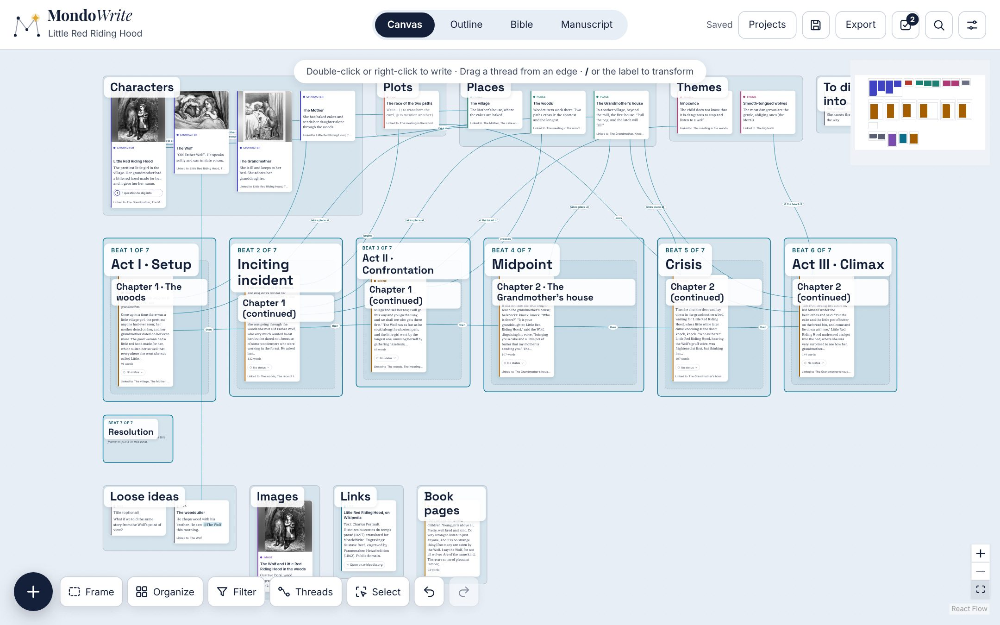<br><b>Organize.</b> One click puts everything into frames: characters, places, acts, chapters.</td>
</tr>
<tr>
<td>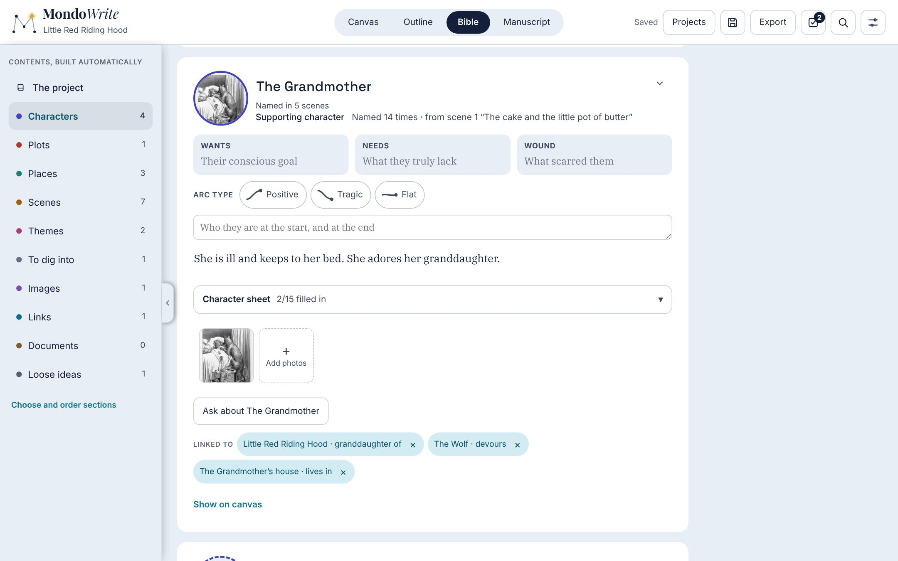<br><b>The Bible.</b> A character’s entry: what they want, what they need, their wound, their arc.</td>
<td>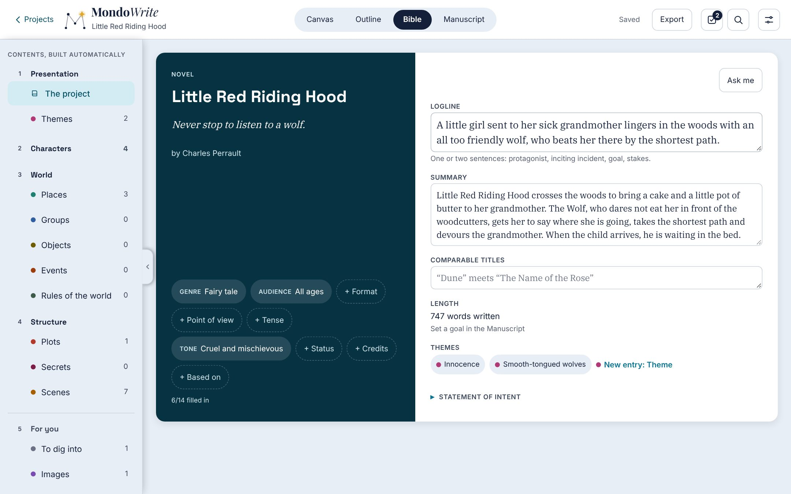<br><b>The cover.</b> Logline, summary, comparable titles: the Bible opens like a pitch package.</td>
</tr>
<tr>
<td>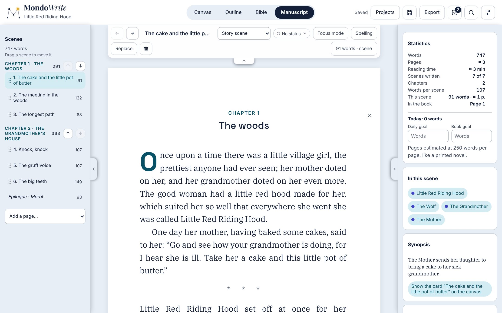<br><b>The manuscript.</b> One scene at a time, on book pages, under the story ribbon.</td>
<td>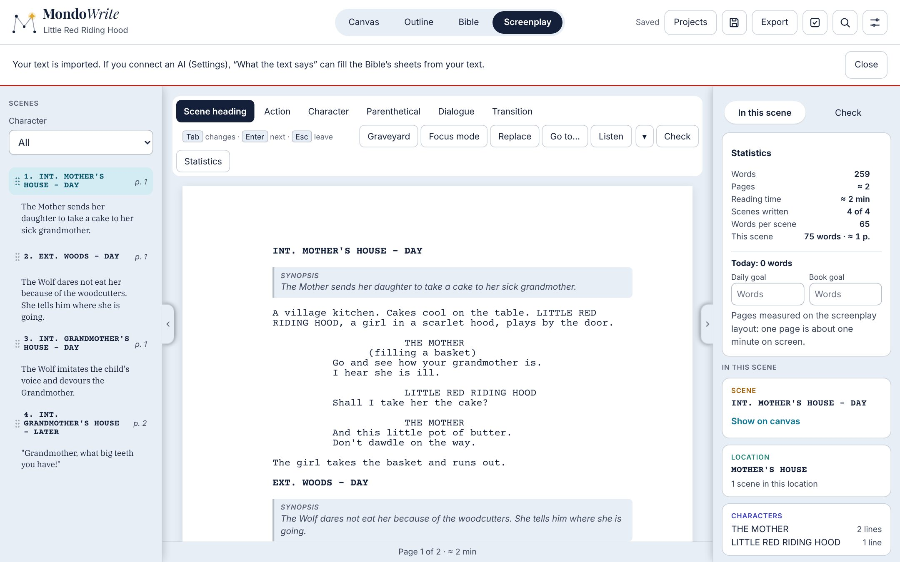<br><b>The screenplay.</b> Industry format, pages and minutes, scenes linked to their cards.</td>
</tr>
<tr>
<td>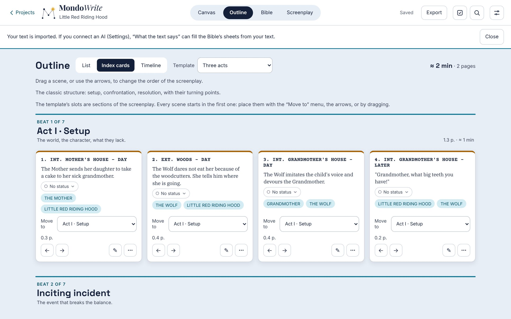<br><b>The Outline.</b> Scenes as index cards, placed in the beats of the structure.</td>
<td>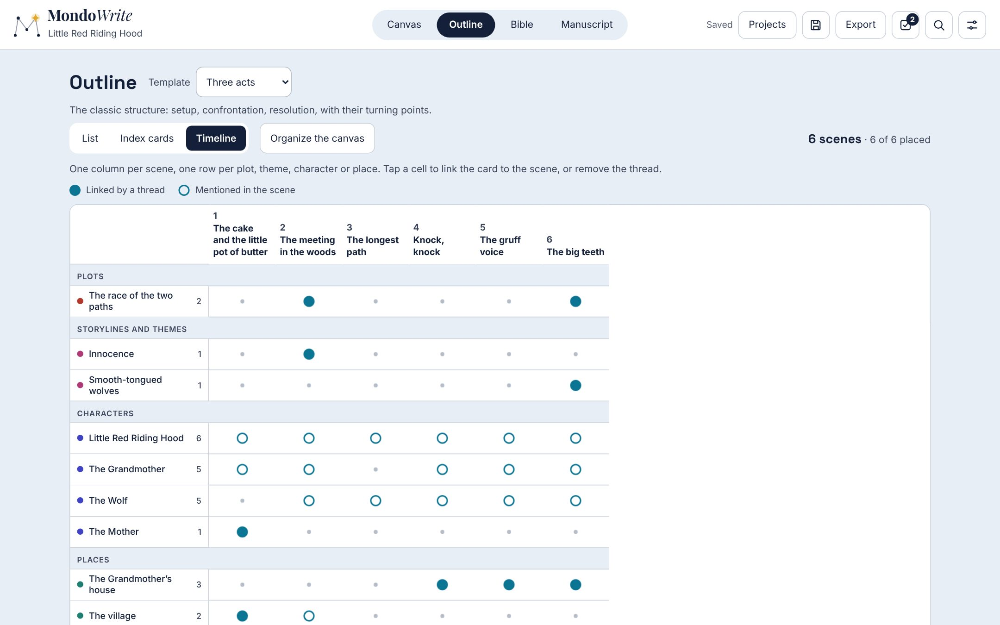<br><b>The timeline.</b> Where each plot, each character, each place appears.</td>
</tr>
</table>

<details>
<summary><strong>More screenshots</strong></summary>

<table>
<tr>
<td width="50%">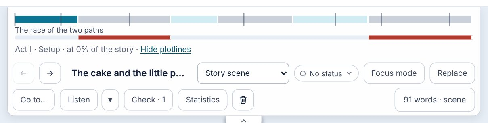<br><b>The story ribbon.</b> How much room each beat really takes, where it usually starts, and a row for each plot.</td>
<td width="50%">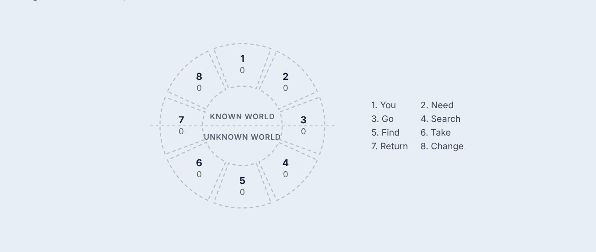<br><b>Dan Harmon’s story circle.</b> The eight steps drawn as a circle, with their scenes.</td>
</tr>
<tr>
<td>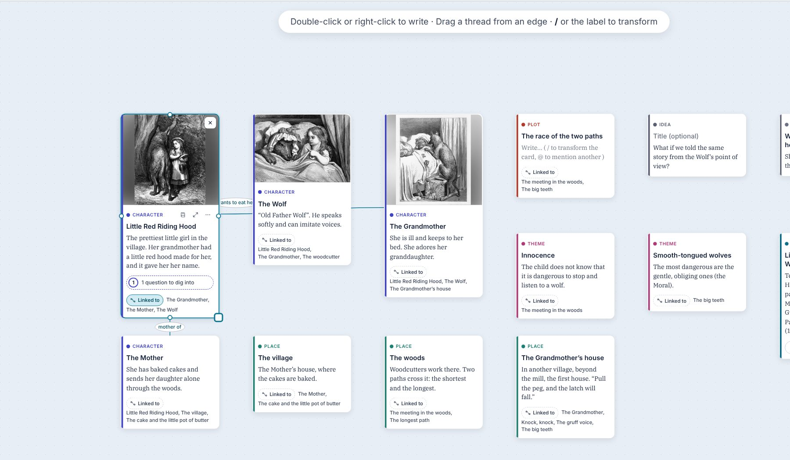<br><b>Hidden threads.</b> “Linked to” at the foot of each card, and one card’s threads turned back on.</td>
<td>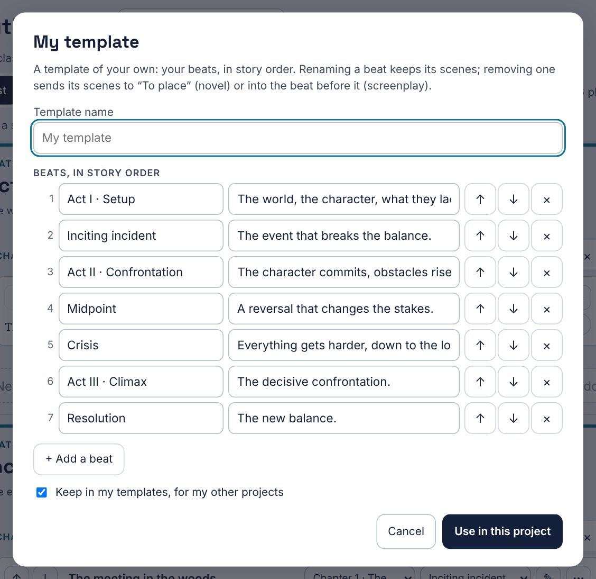<br><b>My templates.</b> Your own beats, kept for all your projects.</td>
</tr>
<tr>
<td>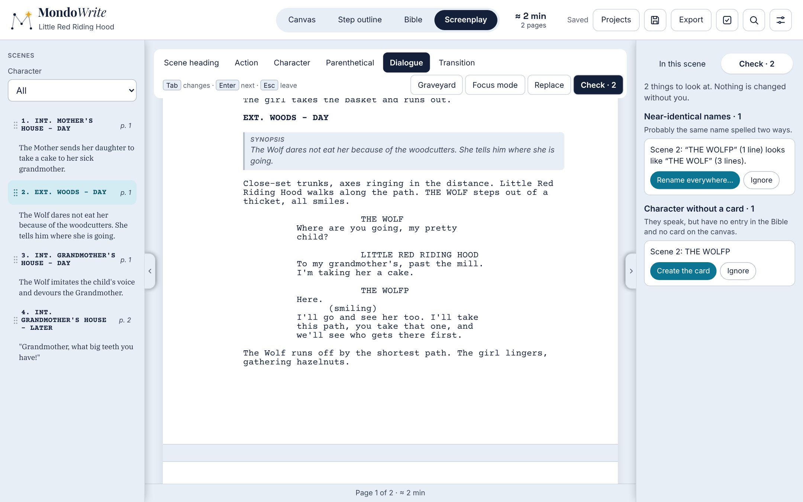<br><b>Check.</b> Points to look at (near-identical names, dialogue…), never a correction.</td>
<td>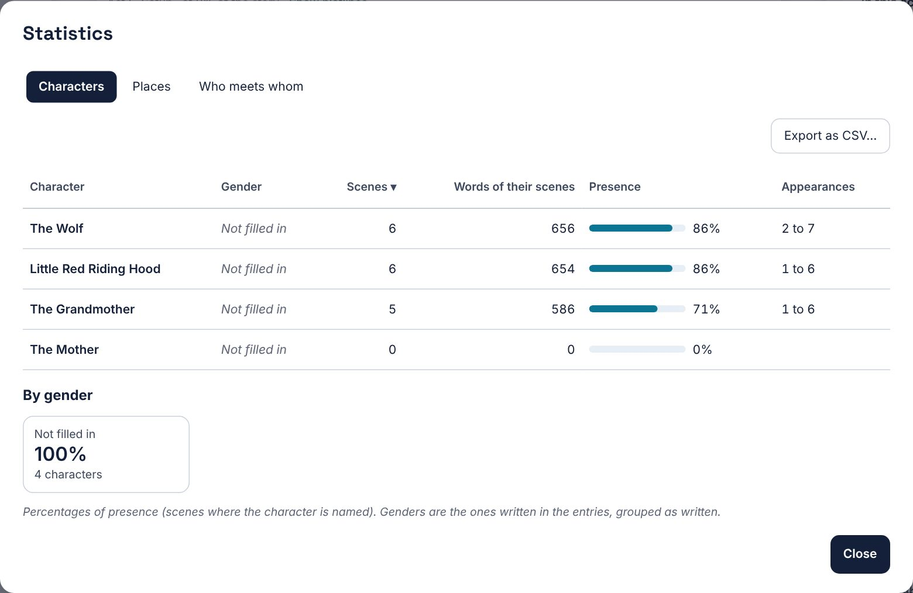<br><b>Statistics.</b> Character presence, locations, who meets whom.</td>
</tr>
<tr>
<td>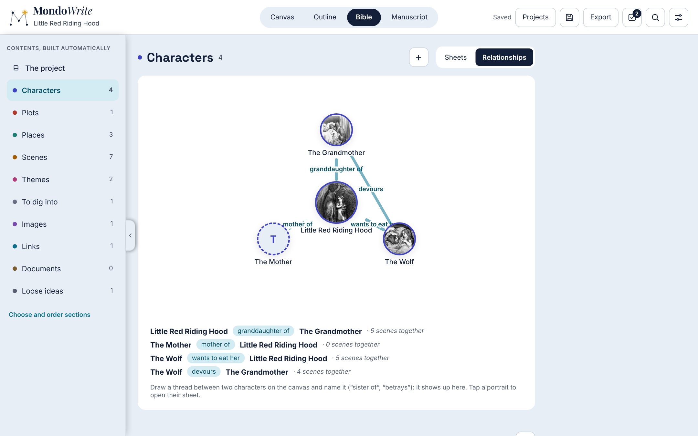<br><b>Relationships.</b> Characters connected by the canvas threads.</td>
<td>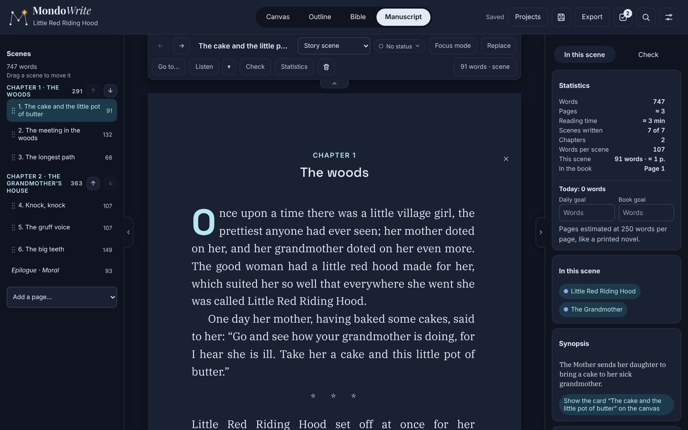<br><b>Dark mode.</b> Everywhere, or following the system.</td>
</tr>
<tr>
<td>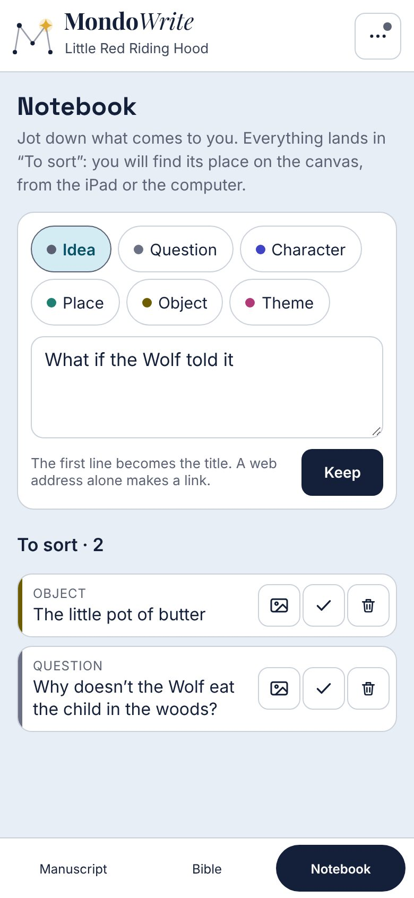<br><b>On iPhone, the Notebook.</b> A note taken on the go becomes a card of the project.</td>
<td>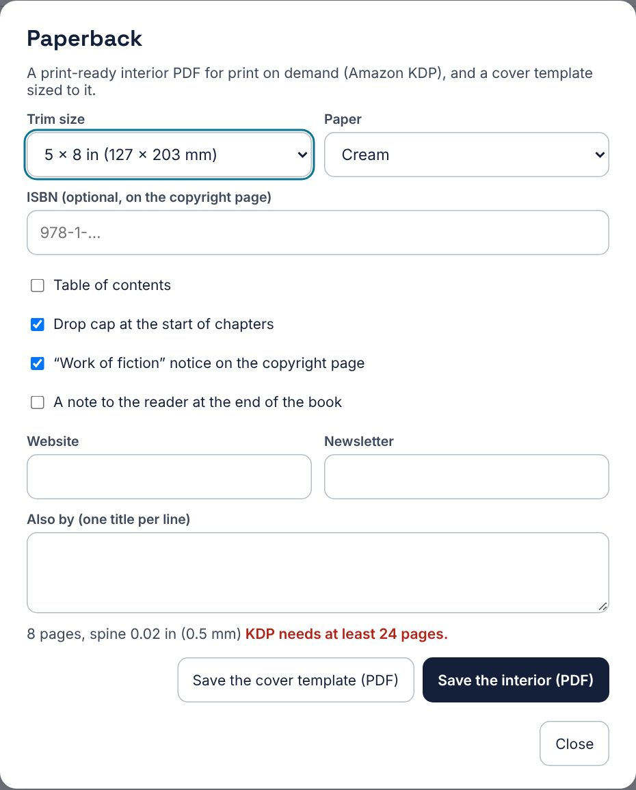<br><b>Paperback.</b> Interior and cover ready for Amazon KDP.</td>
</tr>
</table>

</details>

## 🧱 Ready to write your next world?

[Download MondoWrite](https://mondowrite.app) for free on macOS, Windows or Linux. Writers wanted as testers: your feedback shapes MondoWrite ([contact@mondowrite.app](mailto:contact@mondowrite.app)).

## Download

Installers for macOS (Apple Silicon and Intel), Windows and Linux are available in the [Releases](https://github.com/sebastienpiconnier/MondoWrite/releases).

> **First launch.** On macOS, the app is signed and verified by Apple: it opens normally. On Windows, if SmartScreen appears, click “More info”, then “Run anyway”.

**Updates:** MondoWrite tells you when a new version is out and installs it in one click, after saving your project (Settings, “Updates”, or “About MondoWrite”).

MondoWrite is under active development (version 1.11.3). **Illustrated user guide: [online](https://sebastienpiconnier.github.io/MondoWrite/en/) or [as a PDF](https://sebastienpiconnier.github.io/MondoWrite/MondoWrite-guide-en.pdf) ([français](https://sebastienpiconnier.github.io/MondoWrite/fr/)).** In the app, it opens with F1, from Settings or, on a Mac, the Help menu. Its sources are in [docs/guide](docs/guide).

## Features

### The canvas

- **Free-form cards:** double-click or right-click the canvas, use the “New card” button or press `N`, and start writing its title (`Enter` moves on to the text). Rich text (bold, italic, lists). A new card never lands on top of another.
- **Ten card types:** Idea, Character, Place, Scene, Plot, Theme, Question, Image, Link, Document. Change the type by typing `/` at the start of a line or by tapping the type label.
- **Pasting, as in Milanote:** paste or drop a link or an image onto the canvas: a single **Link** or **Image** card is born where you are (a pasted text becomes an Idea, a Scene if it starts with a heading such as “INT. LIGHTHOUSE - NIGHT”, and a `# …` heading gives it its title). An image address, or an image dragged from a web page, becomes an Image card. Several files dropped at once make one card each, and a `.md` or `.txt` file becomes the card it describes (title, type and sheet of a MondoWrite card or an Obsidian note). Paste an address into a card that is still empty: that card becomes the Link card, without making a second one. “Organize the canvas” sorts them into Images and Links frames, and the Bible has a section for each. For a link, MondoWrite reads the page: title, author, publication date and the site’s image come in on their own. Pasting the same link twice makes only one card. A link keeps the day you read it; “Fill in from the page” adds what is missing, “Open” shows the page.
- **Folded cards:** a card with a long text folds up, “More details” opens it.
- **Formatting and Markdown:** select a word, a bar offers bold, italic, strikethrough, heading, lists, checkbox, quote. Markdown works as you type (`**bold**`, `*italic*`, `# heading`, `- list`, `[ ] task`) and when you paste, in cards, the Bible and the manuscript, and files stay in Markdown.
- **To do:** unticked boxes, passages “to revisit”, questions kept for later and open questions, gathered in one panel, each linked to its card or scene.
- **Keyboard shortcuts** for everything that matters; Ctrl/Cmd+/ lists them.
- **Labeled threads:** drag a thread from one card to another and name the link (“works at”, “suspects”, “takes place at”). The thread always leaves from the nearest edge. Click the thread (or tap it) to rename it or **unlink** the cards; in the Bible, a link’s cross does the same.
- **Mentions:** type `@` (or `[[`, as in Obsidian) in a card to mention another one. The thread is drawn for you, the mention follows when you rename the card, and you can create the mentioned card without leaving your sentence.
- **Images:** drop an image on a card or on the canvas, or go through the card’s ⋯ menu. It keeps its proportions (a blurred backdrop drawn from it fills the sides), is copied into the project’s `medias/` folder and also shows in the Bible.
- **PDF:** drop, paste or import a PDF (“New card” menu, “Document…”): a **Document** card appears, with a preview of its first page, its page count, author and year when the file gives them. “Read the document” opens it in the app, page by page. The PDF is copied into `medias/`.
- **Your author profile:** on the projects page, enter your first name, last name, pen name and contact details once. Every new screenplay puts them on its title page (author and contact), and the exported manuscript carries them on its cover page. They stay on the device and can be edited anytime.
- **Free photos:** the “New card” menu, “Image…” (or “Add photos” in a sheet’s gallery) searches **Openverse** (openly licensed images, no key), **Pixabay** or **Unsplash** (free key, pasted once, kept on the device). The photo you pick becomes an Image card, with the author, link, source and licence in its sheet. “Add an image” in a card’s ⋯ menu (and a character’s portrait in the Bible) opens the same window: a free photo, or an image from the device.
- **Link to the sheet:** every typed card has a button that opens its sheet in the Bible.
- **Multiple selection:** `Shift` + drag draws around cards, `Ctrl`/`Cmd` + click adds one, `Ctrl`/`Cmd`+`A` selects everything, `Esc` deselects; with a finger, the “Select” button. Selected cards move together, and a bar offers to frame them or move them to the trash.
- **Card width:** drag the bottom-right handle of a selected card, or `Alt`+`→` and `Alt`+`←`.
- **New card:** the button creates an Idea (`N` key); its arrow offers every card type (Character, Place, Scene, Plot, Theme, Question, Link, Image, PDF document). A Link waits for its address in its title; an Image offers a free photo or an image from this device.
- **Frames:** a named rectangle (“Act 1?”, “The lighthouse”) to group cards. Button or `C` key; with cards selected, the frame wraps them. Moving it takes its cards and inner frames along. The padlock in its header **locks** it: the frame and its cards stay put, by hand or with “Organise” (the cards can still be edited).
- **Organise the canvas:** one button puts every card in a frame (characters, places, themes, questions, loose ideas, images, links, documents, book pages) and the scenes by template beat and chapter, linked in story order, below the locked frames it leaves in place. Every beat of the structure gets its frame, even an empty one, for novels and screenplays alike; a scene dropped into a frame is placed in that beat. A compact block shaped like the screen: beats follow each other left to right, in rows of scenes whose length depends on the number of cards. `Ctrl`/`Cmd`+`Z` puts everything back.
- **Hidden threads and “Linked to”:** when threads pile up, the “Threads” button hides them all (the choice is kept in the project). At the foot of each card, “Linked to” says what it is connected to: touch it to turn that card’s threads back on, touch a name to center the canvas on that card.
- **Trash:** a deleted card (from the canvas, the outline, the step outline or the manuscript) goes to the trash with its threads, and in a screenplay with its scene’s text. A message offers to undo; the trash (in Settings) puts each card back where it was or deletes it for good. It lives in the project’s `corbeille/` folder.
- **Undo and redo:** `Ctrl`/`Cmd`+`Z` and `Ctrl`/`Cmd`+`Shift`+`Z`, or the two buttons on the canvas. Cards, threads, moves and text.
- **Search:** the magnifier in the top bar, or `Ctrl`/`Cmd`+`F`, finds a card by its title or text and spotlights it on the canvas. It also searches the text of your scenes (manuscript or screenplay) and opens the scene it finds.
- **Find and replace:** `Ctrl`/`Cmd`+`Shift`+`H`, or the “Replace” button in the Manuscript and the Screenplay. In all the text or in the current scene, with or without the cards, whole word or matching case; the number of matches shows as you type, and “Undo” puts everything back. The replacement keeps the shape of the word it replaces (initial capital, or all caps for a screenplay character).
- **Rename everywhere:** in a card’s ⋯ menu, “Rename everywhere…” changes its name and every occurrence in the text. `@` mentions follow on their own.
- **Type colour:** each card has a stripe in its type’s colour, readable at a glance, in light and dark mode.
- **Card menu:** the ⋯ button (or a right-click on the card) adds or changes its image, **spotlights** it (the rest of the canvas fades; a click on the background or Esc brings everything back) or **filters on it** (only its neighbours, by thread or mention, stay visible).
- **Filters:** the “Filter” button in the bottom row hides card types (show only characters and places, for instance). A banner reminds you a filter is on, “Show all” removes it. Nothing is saved, nothing is deleted.
- **Expand a card:** the expand button, or `Ctrl`/`Cmd`+`Enter` on the selected card, opens it large with room to write, its image and its sheet. It is the same card: what you write there is on the canvas at once.
- **A Scene card carries its text:** on the canvas, it shows its synopsis and the start of its scene (a novel’s manuscript, or the screenplay scene). Expanded, it becomes a page where you write the scene: in prose for a novel, in standard format for a screenplay (Tab, Enter, capitals, element bar). It is the same text as in the Manuscript or the Screenplay. Notes a Scene card used to carry move into its synopsis.
- **Minimap and zoom** to find your way as the canvas grows.

### The Bible

The Bible takes the shape of a professional story bible, in five parts: Presentation, Characters, World, Structure, and “For you” (questions, loose ideas, sources). What you fill in is already the document: when exporting, you only choose who it is for and the style.

It opens on **the project cover**, like the back of a book: title, tagline, logline, summary, comparable titles and statement of intent, with chips to tap for genre, audience, format, point of view, tense and tone (a list of common choices, or your own words). The length comes from your word goal, the themes from your Theme cards. Nothing is required.

The Characters section offers a **relationship map**: portraits linked by the canvas threads, with their labels (“sister of”, “betrays”).

Then every entry, generated from your cards, on a single page and grouped by section, with their images and links; the table of contents takes you to each section. The Bible reads like the document it exports: same sections, same order. There is nothing to fill in: the Bible updates as the canvas changes. You can also create and name an entry there: its card shows up on the canvas. Every section is shown, even empty; you choose which to keep and in what order, and the export follows that choice. Everything can be edited in place, title and text. Every entry can have a photo gallery (add by button or drop, enlarge, pick the main picture), places and plots have their own sheet too (atmosphere, period; dramatic question, stakes, inciting incident, obstacles, resolution), and a character has a round portrait, what **drives** them in three boxes read at a glance (Wants, Needs, Wound; for an antagonist: Motivation, Strength, Flaw), their arc type drawn as a curve (positive, tragic, flat), an assistant asking questions **by topic** (the essentials, past, body, voice, emotions, anger, relationships…), whose answers fill the sheet and a **character sheet**: role, gender, age, occupation, nicknames, background, appearance, personality, voice, flaw, fear, secret, relationships, arc. All optional: only filled fields stay on screen. Under the name, the poster sums up gender, age, occupation and role, and says how often the text names them and from which scene.

### The outline

- **Structures to choose from:** free, three acts, Save the Cat, hero’s journey, Dan Harmon’s story circle, five-act pyramid (Freytag), six stages (Hauge), seven points (Dan Wells), kishōtenketsu, romance, mystery. A sentence under the picker says what each one is, and each slot reminds you in one line what belongs there. Harmon’s circle is drawn as a circle, with the scenes of each step.
- **My templates:** “Create a template…” gives you your own beats (a name and a hint for each), from scratch or from the current structure, whose scenes follow. They are kept on the device and offered in all your projects.
- **Story ribbon:** at the top of the Manuscript and the Screenplay, each beat takes the room its scenes really fill (words or pages), with a mark where it usually begins. “Show plotlines” adds a row per plot, “Show the curve” draws the hero’s fortune scene by scene (from “For the hero, the scene ends” in each scene sheet). “Check” flags a beat very far from its usual place.
- **Placing scenes:** drag a scene into a slot, move it with the arrows or pick its slot from a menu. Canvas scenes without a place yet wait under “To place”.
- **Writing from the outline:** a scene created in a slot gets its card on the canvas right away, and its title can be edited from both sides. Each scene has its **synopsis** (what happens, in one sentence), written right in the outline.
- **Chapters:** within each slot, scenes are grouped by chapter. “New chapter from here” cuts the story at a scene; the number follows on its own, the title is optional.
- **Changing your mind:** switching templates loses nothing, each template keeps its own arrangement.
- **List or index cards:** the outline shows as a list or as index cards.
- **Timeline by storyline:** a table of scenes where each storyline (a Theme card), character and place has its row. You see at a glance where a storyline goes missing for too long, and you link a card to a scene by tapping a cell.

### The character assistant

- **Questions, not answers:** in a character’s entry, “Ask about” puts one question at a time, sorted by topic (the essentials first, then past, body, voice, daily life, emotions…). Fill in the sheet or let the questions guide you: both lead to the same place.
- Your answer fills the matching field of the sheet (Wants, Wound, Voice…) when it is empty; other answers go to “Answers to questions”, folded under the sheet and editable. You can also skip to another question.
- **“I don’t know yet”** keeps the question for later, under the entry’s “To dig into” tab. On the canvas, the character’s card only shows “3 questions to answer”, which opens the entry.
- **AI summary** (if an AI is plugged in): it puts what you wrote about the character (sheet, notes, answers) in order, without inventing anything. You add it to the entry or ignore it.

### The manuscript

- **Chapters as you write, as in NEO:** Enter twice on an empty line breaks the scene, the rest goes into a new scene; Enter a third time starts a new chapter. Each break is announced at the bottom of the page with an “Undo” button; Backspace in the empty scene undoes it too. The chapter number and title sit at the top of the page, as in a book.
- **The pages of a book:** a scene can become a title page, copyright, dedication, epigraph, prologue, epilogue, acknowledgments or “about the author”. They place themselves before or after the story, and each one says what goes there (“Who is this book for?”).
- **One scene at a time, on pages:** you write the text of each scene in outline order, on book-format pages sized to your screen (indents, justified text, a drop cap at each chapter opening), numbered from one scene to the next. Scenes are grouped by chapter; move a chapter by dragging it in the left column, or with its arrows. A scene too: drag it (above or below another), use its arrows, or Alt+↑ / Alt+↓; it joins the chapter of its new neighbour. Above the page, a quiet bar: the scene title, the page type, focus mode and the trash.
- **Focus mode:** the page alone on screen, typewriter-style if you like (the current line stays at eye level), with the sentence, line or paragraph in full ink and the rest faded. Ctrl/Cmd+Shift+X marks a passage “to revisit”.
- **Statistics and goals:** words, pages, reading time, scenes written, average per scene; words written today, days in a row, daily goal and book goal (an idea taken from NEO).
- **Import a manuscript:** on the projects page, “Import a manuscript or a screenplay…” turns a Word (`.docx`), PDF, Markdown or text file into a novel project (a screenplay PDF is recognized by its layout and becomes a screenplay project). Chapters come from headings, page breaks and “Chapter 3” lines; separators (`***`, `#`, `* * *`) split the scenes, each with its card; bold and italics are kept, a prologue and an epilogue become book pages (rules taken from NEO).
- **Scene status:** draft, to revise or done, a coloured dot on the card, in the Outline, the step outline and the scene list. The statistics count the scenes done.
- **The synopsis as a watermark:** an empty scene shows its synopsis in grey, like an outline note, until you write.
- **In this scene:** characters and places mentioned in the text show up beside it, along with the scene’s synopsis, editable in place.
- **Go to** (Ctrl/Cmd+G): a page, a scene, a chapter, a passage to revisit or a note.
- **Listen:** the text read aloud by the device’s voices, one voice per character and a narrator, the passage being read highlighted.
- **Check and Statistics:** beside the text, the “Check” tab asks questions (a main character with no “Wants”, a secret never revealed, a beat far from its place), and the Statistics window counts how present characters and places are.
- **Your files:** every written scene is a Markdown file in `manuscrit/`. Deleting a card never erases its text: it goes to the trash and comes back with it.

### Novels and screenplays

A project is a novel or a screenplay, and you can switch at any time. The canvas and the files stay the same, only the vocabulary adapts: Place becomes Location, the Outline lays out scenes instead of chapters, the Manuscript becomes the Screenplay, and Scene cards take the shape of a scene heading (`INT. LIGHTHOUSE - NIGHT`) in Courier Prime.

### The screenplay editor

For a screenplay project, the Screenplay view is an editor in standard film format, linked to the canvas: each scene heading is tied to its Scene card, and what you write in one shows up in the other.


<details>
<summary><strong>Everything the screenplay editor does</strong></summary>

- **Real pages:** the sheet has the proportions and margins of the chosen paper size (A4 or US Letter), page after page, as in print.
- **Title page:** a cover page where you write the title, your name, the “Written by” credit, your contact address and the date. Your name is remembered for your next screenplays.
- **Six elements:** scene heading, action, character, parenthetical, dialogue, transition, with the standard indents.
- **All from the keyboard:** `Tab` changes the element type, `Enter` moves to the next logical element (character, then dialogue, then action). An element bar does the same with a mouse or a finger.
- **Detection as you type:** a line starting with `int.` or `ext.` becomes a scene heading, an opening parenthesis starts a parenthetical.
- **Completion:** characters and locations from the Bible are suggested as you write, along with extensions (V.O., O.S.) and times of day (DAY, NIGHT). An unknown character or location can become a card in one gesture.
- **Linked to the canvas:** renaming a scene heading renames its card, and the other way round. A scene, its location or a character you write in the screenplay gets its card on the canvas; a Scene card created on the canvas enters the screenplay.
- **Pages and minutes:** the page count and the estimated running time (about one minute per page) are always visible.
- **Outline:** the scenes in order, as a list or as index cards, with their synopsis, characters and length. Reorder them by dragging or with the arrows, and the scene’s text follows in the file. In the Screenplay view too, the scene list on the left can be reordered: drag a scene, use the current scene’s arrows, or Alt+↑ / Alt+↓.
- **Outline templates:** three acts, Save the Cat, eight sequences, TV episode (cold open, four acts, tag), hero’s journey, the novel structures and your own templates. Each template and each slot explain what goes there. Slots are sections of the Fountain file, readable in other software, each with its running time.
- **Deleting a scene:** from the step outline, the scene goes to the trash with its text.
- **Synopsis:** one sentence per scene, written from the scene panel or the step outline, saved as a Fountain synopsis.
- **Import:** an existing `.fountain`, Final Draft (`.fdx`) or PDF file becomes a project, with its Scene, Character and Location cards already created and linked.
- **Target lengths per act** in the Outline, **emphasis** (italic, bold) on screen and in the PDF, and side-by-side **dual dialogue**.
- **(MORE) and (CONT'D):** for dialogue split by a page break, in the PDF and on screen.
- **Scene numbers, underlined headings and focus mode:** two buttons in the bar number the scenes in the margin and underline the headings (on screen, in the PDF and in Final Draft), and a mode keeps only the page on screen.
- **An open format:** the text is saved to `scenario.fountain`, in [Fountain](https://fountain.io) format, readable by other screenwriting software.

</details>

### AI, if you want it

MondoWrite works entirely without AI. You can plug one in from Settings:

- **Locally**, with Ollama or LM Studio: your texts never leave your machine. No server setting needed.
- **With your own key**, for Claude, OpenAI or OpenRouter: the passages being analysed are then sent to that provider, under its terms. Your key stays on your device, never in the project.

It asks, it doesn’t write: no action changes your project without your say.

- **Tidy up ideas:** suggests a type (Character, Place, Scene…) for your loose ideas. You apply or ignore them one by one, then “Organise the canvas” puts everything in frames.
- **Tailored questions:** in the character assistant, a question based on what the entry already says. You do the answering.
- **Character summary:** puts what you wrote in order, adding nothing.
- **Describe a photo:** if you ask, from a sheet’s gallery, the AI notes what the photo shows (light, materials, atmosphere), inventing nothing. For a **character**, it also suggests an apparent age and appearance: each field is added to the sheet, replaces it or is ignored, in one click. It never says who the person is and never guesses origin, religion, health or personality. It needs a model that can read images.
- **Check consistency:** points out possible contradictions between your cards (an age, a date, a place), as questions you can keep for later.

When the AI talks about a card, it names it by its title and type, for example “Inès Morvan (character)”.

The exact instructions sent to the AI are published in [docs/prompts-ia.md](docs/prompts-ia.md) (in French, with the prompts themselves in English).

### Exports

- **Manuscript:** scenes of the same chapter form one chapter, separated by “* * *”. PDF in Shunn manuscript format, the one agents and editors expect (Courier 12, double spaced, “Name / TITLE / page” header, rounded word count on the title page, each chapter on a new page, “#” between scenes, bookmarks per chapter), Word (.docx), EPUB for e-readers, or a single Markdown file.
- **Paperback (KDP):** a print-ready interior PDF for Amazon KDP print on demand, and a cover template sized to it. Four trim sizes (5 × 8 to 6 × 9 inches), mirror margins with a gutter set by page count, chapters on right-hand pages, page 1 at the start of the story, running heads and folios at the outside corners, justified and hyphenated text (French, English), widows and orphans avoided, drop caps. A default copyright page (all rights reserved, fiction notice, ISBN) when the book has none of its own, a table of contents with page numbers, a note to the reader with your links, “Also by”, bookmarks per chapter. The cover template gives the spine for the paper, the bleed, the safe areas and the barcode area. Settings are kept in the project.
- **Screenplay:** PDF in standard format (Courier 12, standard margins, dialogue split cleanly across pages), Fountain and Final Draft (FDX).
- **Bible:** PDF, Word or Markdown, the project cover first, then the sections chosen in the Bible, in its order, with each entry’s images and links. For yourself, or for someone else (pitch package, series bible), in three styles; character sheets follow one another.
- **Canvas:** a PNG image of the whole board, a standard PDF (A4, to send) or large-format PDF (A1, to print), and the card text in Word or Markdown, one part per frame.
- **Nothing to install:** everything is produced by the app itself.

### Comfort

- **Several projects:** a home screen to choose the one to work on, or to create one.
- **Autosave** to Markdown files, or `Cmd+S` / `Ctrl+S`.
- **English and French**, each with its own typography.
- **Typography as you type** (manuscript, cards, Bible): curly quotes “ ”, apostrophe ’, ellipsis …, a dash from two hyphens; in French, « » with non-breaking spaces and a thin space before ; ! ?. Follows the language, or set it in Settings (or turn it off).
- **Light, dark or system appearance.**
- **Mouse, touch and keyboard:** every action has all three paths.
- **Offline:** bundled fonts, no account, no server.
- **One-click updates** (desktop): checked at most once a day, can be turned off; nothing is installed without your OK.


## Getting started

- **Choose a project:** on every launch, the home screen lists your projects. From a project, the “Projects” button saves and goes back there.
- **New project:** a working title, novel or screenplay, and on a computer the folder to save it in. “Try with an example” creates a full project, Perrault’s “Little Red Riding Hood” illustrated by Gustave Doré (characters, places, a three-act outline, chapters and the tale written in the manuscript), and opens a six-step guided tour (it stays in Settings).
- **New card:** double-click or right-click the canvas, press `N`, or use the “New card” button. Then just write. A long press on a card (finger, pen or mouse) lifts it: it is selected, with a drop shadow, ready to be moved.
- **Change the type:** type `/` at the start of a line, or tap the type label (“IDEA”).
- **Connect:** drag a thread from a point on a card’s edge to another card, then name the link.
- **Settings** (icon at the top right): project type, trash, interface language, appearance, and AI service.

### Your files

Each project is a folder:

- `cosmos.json`: title, positions, links and frames
- `cartes/*.md`: one card per Markdown file
- `manuscrit/`: the text of the scenes (novel)
- `scenario.fountain`: the screenplay text
- `medias/`: images
- `corbeille/`: deleted cards, ready to restore
- `markdown/`: the manuscript, bible and canvas as three Markdown files, with their images and links between entries, to read outside MondoWrite (Obsidian, Typora, GitHub…). They are rewritten at every save: edit the text in the app, not in these copies. `markdown/versions/` keeps one version a day for 30 days, then one a month. You can turn this off in the project Settings.

File and folder names are the same in every language.

```markdown
---
id: k3x9a7bq2m
type: personnage
title: "Inès Morvan"
---
Stand-in keeper. Can’t stand **silence**.
```

**Working on several computers:** put the project folder in iCloud Drive, Dropbox or OneDrive, and avoid opening it on two machines at once. The folder you choose stays allowed from one launch to the next, wherever it is (another drive, OneDrive, a USB stick). If the app can no longer open it, it tells you and you choose it again with “Open folder”.

**Changed elsewhere:** if a project file changes outside MondoWrite (another editor, a sync), the app picks it up on its own. If it also changed in the app, nothing is overwritten: your version is kept next to it, in a “… (MondoWrite).md” file, and a banner lets you choose which to keep.

**Cannot save:** the message says why (disk full, access denied, folder not found) and offers to retry, to point to where the project folder went, or to export a full copy as a .zip.

## Coming next

| Step | Content |
|---|---|
| Mobile | iPad and iPhone on the App Store, then Android |
| Sync | Beyond iCloud, then collaboration |

## Platforms

| System | Status |
|---|---|
| macOS (Apple Silicon and Intel), Windows, Linux | Ready: installers built by GitHub Actions |
| iPadOS, iOS | In testing (TestFlight); on iPhone, the app becomes a Notebook; projects shared with the Mac through iCloud |
| Android | Code is ready (touch, storage), not yet released |
| Browser | For development only (storage in the browser) |

---

## Development

**Stack:** Tauri 2, React 19, strict TypeScript, Vite, React Flow for the canvas, TipTap for the editor, Zustand for state.

### Requirements

- Node 20+ and Rust (https://rustup.rs)
- **Mac:** the Xcode command line tools (`xcode-select --install`)
- **Windows:** the Visual Studio Build Tools (C++) and WebView2 (already on Windows 10 and 11)
- **Linux:** `libwebkit2gtk-4.1-dev` and its dependencies (see `ci.yml`)

### Run

```bash
npm install
npm run tauri dev      # desktop app
# or
npm run dev            # in the browser (http://localhost:1420), no disk access
```

**Mobile (on a Mac):** `npm run tauri ios init`, `npm run ios:prepare` (icons) then `npm run tauri ios dev` (Xcode required; step by step, pitfalls and TestFlight in [docs/ios.md](docs/ios.md), in French), or `android init` / `android dev` (Android Studio and NDK required). On mobile, projects live in the app’s private storage.

### Check

```bash
npm run build   # TypeScript check + build
npm test        # tests (Vitest)
```

### Release a version

```bash
git tag v0.1.0 && git push --tags
```

GitHub builds the installers for all three systems and puts them in a draft Release, which you then publish. The secrets needed to sign the apps (Apple developer account, update signing key) are listed in `release.yml`. The Windows installers are not signed. A Release published normally (not as a pre-release) is the one the app finds and installs.

### Working on several computers

The code goes through GitHub: `git push` at the end of a session, `git pull` then `npm install` if needed at the start of a session on the other machine. Don’t put the code folder in OneDrive or iCloud.

### Documentation

Architecture, conventions and detailed roadmap: see [CLAUDE.md](CLAUDE.md) (in French), written for working with Claude Code.

## License

MondoWrite is free software, released under the [GNU AGPL v3.0 or later](LICENSE) (GNU Affero General Public License). You can use, study, change and redistribute it; any modified version you distribute must stay under the same license. The AGPL adds one rule to the GPL: a modified version offered to others over a network (an online service, for example) must also give them access to its source code.

The PDF embeds the Courier Prime font (SIL OFL license, see [OFL.txt](src/assets/fonts/OFL.txt)), and the paperback the Crimson Text font (SIL OFL license, see [OFL-CrimsonText.txt](src/assets/fonts/OFL-CrimsonText.txt)). Hyphenation uses TeX patterns from the `hyphen` package.

Manuscript import and the paperback export reuse rules from Hugh Howey’s [NEO](https://github.com/hughhowey/neo) (MIT license). Copyright notices and licenses for everything MondoWrite reuses or bundles are gathered in [THIRD-PARTY-NOTICES.md](THIRD-PARTY-NOTICES.md).

To contribute, see [CONTRIBUTING.md](CONTRIBUTING.md).

The example project uses Charles Perrault’s “Le Petit Chaperon rouge” (*Histoires ou contes du temps passé*, 1697) and three engravings by Gustave Doré, wood-engraved by Pannemaker (Hetzel edition, 1862), all in the public domain. The English translation of the tale was made for MondoWrite.
